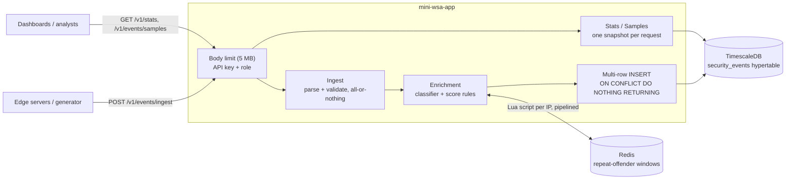
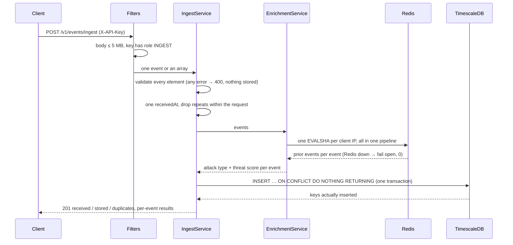
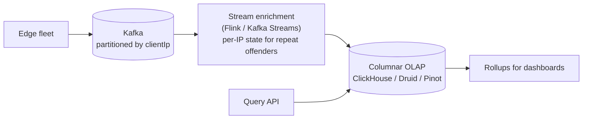

# Mini WSA

A small security analytics pipeline: a Spring Boot service that ingests web security events, enriches them with an attack type and a threat score (including a Redis-backed repeat-offender rule), stores them in PostgreSQL + TimescaleDB, and serves statistics and paginated samples over a REST API. A separate generator simulates realistic traffic with attack waves.

**Stack:** Java 21 (virtual threads) · Spring Boot 4.1 · PostgreSQL 17 + TimescaleDB · Redis · Flyway · JdbcTemplate · Spring Security (API keys) · springdoc (OpenAPI) · Testcontainers · Docker Compose.

> **Status:** every core requirement is complete as of `v1.0.0`. The optional bonus features (time series, rate limiting, alerting) are not implemented; how I would build them is under [What I'd improve](#what-id-improve-with-more-time).

## Quick start

Requires Docker (Docker Desktop on Windows/macOS). Java 21 is only needed to build or test outside Docker.

Bash (Git Bash, macOS, Linux):

```bash
git clone https://github.com/bensopher/mini-wsa.git
cd mini-wsa
docker compose up --build -d
docker compose --profile seed run --rm seed
curl http://localhost:8080/v1/stats/summary -H "X-API-Key: dev-read-key"
```

PowerShell (use `curl.exe`: plain `curl` is an alias for `Invoke-WebRequest`):

```powershell
git clone https://github.com/bensopher/mini-wsa.git
cd mini-wsa
docker compose up --build -d
docker compose --profile seed run --rm seed
curl.exe http://localhost:8080/v1/stats/summary -H "X-API-Key: dev-read-key"
```

The first build downloads dependencies and takes a few minutes. The seed step waits until the app is ready, sends 10,000 generated events from the last hour, and prints a throughput summary; the stats call then summarizes the last 24 hours. To send a single event yourself, see [`POST /v1/events/ingest`](#post-v1eventsingest).

### Run modes

| Mode | Commands |
|---|---|
| Everything in Docker | `docker compose up --build -d` |
| Seed it with generated events | `docker compose --profile seed run --rm seed` (10,000 events; see [Data generator](#data-generator) for options) |
| App from source (database in Docker) | `docker compose up -d db redis`, then `./mvnw -pl mini-wsa-app spring-boot:run` (PowerShell: `.\mvnw.cmd -pl mini-wsa-app spring-boot:run`) |
| Tests | `./mvnw verify` (PowerShell: `.\mvnw.cmd verify`); Docker must be running |

If ports 5432, 6379 or 8080 are already in use, remap them: `DB_PORT=5433 REDIS_PORT=6380 APP_PORT=8081 docker compose up -d` (bash) or `$env:DB_PORT=5433; $env:REDIS_PORT=6380; $env:APP_PORT=8081; docker compose up -d` (PowerShell). When running the app from source, set `DB_PORT` the same way.

The database credentials and API keys in `docker-compose.yml` and `application.yml` are **dev-only** defaults.

## Architecture



One ingest request:



**Code layout** (`com.bensopher.miniwsa`, package by feature):

| Package | Contains |
|---|---|
| `event` | Domain records and enums shared by every feature (`SecurityEvent`, `Severity`, `Category`, `Action`, ...) |
| `common` | Cross-cutting pieces: error handling (RFC 9457), JSON hardening, body-size filter, `TimeRange`, `SqlFilter`, read-query timeout, OpenAPI |
| `security` | API-key authentication and the role rules |
| `ingest` | `POST /v1/events/ingest`: parsing, validation, duplicate detection, the write repository |
| `enrichment` | Attack-type classifier, score rules and calculator, Redis repeat-offender tracker |
| `stats` | `GET /v1/stats/summary` |
| `samples` | `GET /v1/events/samples` |
| `mini-wsa-generator` (module) | The traffic generator: a separate CLI that only talks to the HTTP API |

Repository classes are the only code that contains SQL.

## Storage choice

**PostgreSQL 17 with TimescaleDB.** For this scope it is the right fit: one familiar, ACID database that `docker compose` runs as a single service, with rich SQL for the aggregations, unique keys for idempotent ingestion, and read-after-write consistency. TimescaleDB adds the time-series features:

- **Hypertable** `security_events`, partitioned into daily chunks by event time, so a time-range query only reads the chunks it needs. Primary key `(event_id, event_time)`, plus an index on `(config_id, event_time DESC)` for the common "one config over a time range" filter.
- **Compression:** chunks older than 7 days are converted to TimescaleDB's compressed columnar format, segmented by `config_id` and ordered by `event_time DESC, event_id`. Late events, retries and stats keep working on compressed chunks (an integration test compresses a chunk and checks all three). `event_id` is in the ordering because it is part of the primary key: each compressed batch keeps its min/max, so the duplicate check for a retried event only decompresses batches that could contain it.
- **No retention policy**, on purpose: replayed or historical events (such as the May 2026 sample) would silently disappear. See "What I'd improve".
- **Next steps within TimescaleDB:** continuous aggregates (pre-computed per-minute rollups) for dashboards, and `time_bucket_gapfill` for time series.

**Honest limits.** It is still a single-node row store at heart. High-cardinality `GROUP BY client_ip` over billions of rows, or ingestion beyond roughly 100k events/s on one node, will not hold up at WSA scale.

**At Akamai scale** the design would change shape (A10):



Partitioning by client IP sends every event from one IP to one consumer, so the repeat-offender window becomes local state with exactly-once checkpoints instead of a Redis round trip, and Kafka is the durable buffer that lets ingestion acknowledge before enrichment. Because SQL lives only in the repository classes, swapping the store doesn't touch the API or the enrichment logic.

**Alternatives considered** (for this assignment):

| Store | Why not here |
|---|---|
| ClickHouse | Excellent for aggregations at billions of rows and the likely target at scale, but no enforced unique key (duplicates are merged eventually, not rejected at insert), so idempotent ingestion with exact `stored`/`duplicates` counts would need extra machinery |
| Elasticsearch / OpenSearch | Strong for searching paths and user agents, but aggregations on high-cardinality fields are approximate, there is no unique constraint for idempotency, and it is a heavier cluster to run |
| Druid / Pinot | Built for real-time OLAP from Kafka, exactly the at-scale design, but several services to operate for a single-node assignment |
| Cassandra | Scales writes linearly, but has no ad-hoc `GROUP BY`: every stats query would need its own precomputed table |

## Enrichment and threat scoring

Every stored event gets an **attack type** and a **threat score** (0–100), computed once at ingest.

### Attack type

| `rule.category` | `attackType` |
|---|---|
| `INJECTION` | SQL/Command Injection |
| `XSS` | Cross-Site Scripting |
| `PROTOCOL_VIOLATION` | Protocol Anomaly |
| `DATA_LEAKAGE` | Data Exfiltration |
| `BOT` | Bot Activity |
| `DOS` | Denial of Service |
| `RATE_LIMIT` | Rate Limiting |

### Threat score

The score is the sum of independent rules, capped at 100. Each rule is its own class (`ScoreRule`), so a new rule is a new class; weights live on the enums and in `miniwsa.scoring.*`.

| Rule | Points | Configured in |
|---|---|---|
| Severity | `CRITICAL` 40, `HIGH` 30, `MEDIUM` 20, `LOW` 10 | `Severity` enum |
| Action | `DENY` +20, `ALERT` +10, `MONITOR` +0 | `Action` enum |
| Sensitive path | +15 if the path contains `/admin` or `/login`, case-insensitive (A7); `/administrator` matches, `/wp-admin` doesn't | `miniwsa.scoring.sensitive-path` |
| Repeat offender | +15 if at least 5 *other* events from the same client IP fall in the 10 minutes up to this event (A5, A6) | `miniwsa.scoring.repeat-offender` |

Example: the sample event (`CRITICAL`, `DENY`, `/api/v1/login`) scores 40 + 20 + 15 = **75**, or **90** from a repeat offender.

With these weights the maximum is 40 + 20 + 15 + 15 = **90**, so the cap of 100 never triggers today. It is still implemented and tested, because weights are configurable and rules get added.

### Repeat-offender rule

State lives in **Redis**: one sorted set per client IP (`miniwsa:ro:<ip>`), member = `eventId:timestamp`, score = event time in milliseconds. A Lua script counts, records and prunes in one atomic step.

| Property | How |
|---|---|
| **Event time (A5)** | The window is `[event.timestamp − 10m, event.timestamp]`, so out-of-order arrivals are counted by when they happened, not when they arrived. A batch is processed in event-time order, so earlier events of the same request count (A6). |
| **Scores are frozen at ingest** | A late event doesn't re-score events already stored. |
| **Atomic across instances** | Each IP's update is one Lua script call, which Redis runs atomically, so several app instances see consistent counts. This is why the state is in Redis, not in an in-memory map. |
| **Idempotent (A4)** | The member is the event's identity, so a retried event neither counts itself nor inflates the others; the same `eventId` at another time is another event. |
| **Efficient** | One script call per IP per request, all sent in a single pipeline: one round trip per request. |
| **Bounded memory** | Entries older than 1 hour before the IP's newest event are pruned (relative to event time, so historical data works), and idle IPs expire after 2 hours. |
| **Cluster-ready** | Each script call touches a single key, so it also works on Redis Cluster (a multi-key script across IPs wouldn't). |

**Trade-offs:**
- **Redis is written before Postgres.** If the database insert then fails, Redis remembers events that were never stored. A client retry is still safe (idempotent), at the cost of slightly inflated counts for events that are never retried. The production fix is a log-based pipeline: Kafka partitioned by client IP feeding a stateful stream processor.
- **Fail open.** If Redis is down or hanging, ingestion continues: events are scored without the repeat bonus, and every affected request increments the `miniwsa.enrichment.repeat_offender.unavailable` metric (alert on it). One `WARN` is logged when the outage starts and one `INFO` when Redis is back, rather than a line per request that would flood the logs during an attack. In security analytics, losing events is worse than under-scoring some for a while. Redis timeouts are 500 ms (Lettuce's default is 60 s), so an outage costs at most about half a second per request; an integration test pauses and stops Redis to prove it.
- **Redis isn't part of readiness.** Since ingestion works without it, the readiness probe checks only the database; otherwise a Redis outage would take every instance out of the load balancer. See [Observability](#observability).

## API reference

### Authentication

**Swagger UI:** <http://localhost:8080/swagger-ui.html> (OpenAPI document at `/v3/api-docs`). Click **Authorize**, enter a dev key, and every request from the UI sends it.

Every endpoint except `/actuator/health` (and its `liveness` and `readiness` probes) and the Swagger pages requires an `X-API-Key` header whose key has the required role. The dev keys (overridable with the environment variables shown) are:

| Key | Env variable | Roles | Can |
|---|---|---|---|
| `dev-ingest-key` | `MINIWSA_INGEST_KEY` | `INGEST` | ingest events |
| `dev-read-key` | `MINIWSA_READ_KEY` | `READ` | read stats and samples |
| `dev-admin-key` | `MINIWSA_ADMIN_KEY` | `READ`, `ADMIN` | read, `/actuator/info`, `/actuator/metrics` |

A missing or unknown key gets `401`; a key without the required role gets `403`.

### Errors

Every error is an [RFC 9457](https://www.rfc-editor.org/rfc/rfc9457) problem (`Content-Type: application/problem+json`) with a stable `type` URI. Validation errors, in the body or in query parameters, list every problem in an `errors` array:

| Field | Meaning |
|---|---|
| `index` | Position in the batch (omitted for a single-object request and for query parameters) |
| `field` | Dotted path, e.g. `rule.severity`, or the query parameter's name |
| `message` | What is wrong; enum errors list the allowed values |
| `rejectedValue` | The value received (omitted when absent) |

| Status | `type` suffix | When |
|---|---|---|
| 400 | `validation` | One or more fields are invalid |
| 400 | `malformed-json` | The body is not JSON, or exceeds the nesting (20) or string-length (64 KB) limits |
| 401 | `unauthorized` | Missing or unknown API key |
| 403 | `forbidden` | The key lacks the required role |
| 413 | `payload-too-large` | Body over 5 MB, or more than 1000 events |
| 415 | (Spring default) | `Content-Type` is not `application/json` |
| 500 | `internal` | Unexpected error; the body only carries an `errorId` that matches the server log |
| 503 | `service-unavailable` | A read query ran past its 5 s timeout, or no database connection was free within 2 s. Sent with `Retry-After: 5`; nothing was stored, so retrying is safe |

### `POST /v1/events/ingest`

Role: `INGEST`. Body: one event object, or a JSON array of up to 1000 events.

| Field | Required | Rule |
|---|---|---|
| `eventId` | yes | non-blank, ≤ 128 characters |
| `timestamp` | yes | ISO-8601 with an offset (`Z` or `+02:00`); normalized to UTC; at most 5 minutes in the future |
| `configId` | yes | positive integer (a JSON number: `"123"` and `1.5` are rejected) |
| `policyId` | no | ≤ 128 |
| `clientIp` | yes | IPv4 or IPv6 literal (no hostnames, no zone IDs); stored in canonical form |
| `hostname` | no | ≤ 253 |
| `path` | yes | starts with `/`, ≤ 2048 |
| `method` | yes | any HTTP token, ≤ 16 (attack traffic uses non-standard methods) |
| `statusCode` | no | 100–599 |
| `userAgent` | no | ≤ 1024 |
| `rule.id` | yes | non-blank, ≤ 32 |
| `rule.name`, `rule.message` | no | ≤ 128 / ≤ 512 |
| `rule.severity` | yes | `CRITICAL`, `HIGH`, `MEDIUM`, `LOW` (case-sensitive) |
| `rule.category` | yes | `INJECTION`, `XSS`, `PROTOCOL_VIOLATION`, `DATA_LEAKAGE`, `BOT`, `DOS`, `RATE_LIMIT` |
| `action` | yes | `DENY`, `ALERT`, `MONITOR` |
| `geoLocation.country` | no | ISO 3166-1 alpha-2 (`US`) |
| `geoLocation.city` | no | ≤ 128 |
| `requestSize`, `responseSize` | no | ≥ 0 |

Unknown fields are ignored, so producers can add fields without breaking ingestion. No string anywhere in an event may contain the NUL character (`\u0000`), which Postgres can't store.

**Behavior**

- **All-or-nothing (A1).** If any event is invalid, the response is `400` listing every error, and nothing is stored. Each element is converted separately, so a type error is reported with its index. A type error stops checks on that element, so its other fields are validated once the type is fixed.
- **Duplicates (A4).** An event is identified by `(eventId, timestamp)`. Sending it again stores nothing and reports it as a duplicate; a request made only of duplicates still returns `201`, so retries are safe. The same `eventId` with a different timestamp is a different event.
- **Enrichment.** Each event in the response carries its `attackType` and `threatScore` (see [Enrichment and threat scoring](#enrichment-and-threat-scoring)). For a duplicate they are computed for this request and not stored; the stored row keeps the score from its first ingestion.
- **Durable acknowledgment.** `201` means the events are committed to the database. Ingestion is synchronous on purpose: there is no in-memory queue that could lose acknowledged events.

Single event:

```bash
curl -X POST http://localhost:8080/v1/events/ingest \
  -H "Content-Type: application/json" -H "X-API-Key: dev-ingest-key" \
  --data-binary @examples/single-event.json
```

```powershell
curl.exe -X POST http://localhost:8080/v1/events/ingest -H "Content-Type: application/json" -H "X-API-Key: dev-ingest-key" --data-binary "@examples/single-event.json"
```

```json
{
  "received": 1, "stored": 1, "duplicates": 0,
  "receivedAt": "2026-11-17T17:56:17.558Z",
  "events": [
    { "eventId": "evt-00132", "attackType": "SQL/Command Injection", "threatScore": 75, "duplicate": false }
  ]
}
```

Batch (`examples/batch-events.json`: its third event repeats the single event above, so it is reported as a duplicate):

```bash
curl -X POST http://localhost:8080/v1/events/ingest \
  -H "Content-Type: application/json" -H "X-API-Key: dev-ingest-key" \
  --data-binary @examples/batch-events.json
```

```powershell
curl.exe -X POST http://localhost:8080/v1/events/ingest -H "Content-Type: application/json" -H "X-API-Key: dev-ingest-key" --data-binary "@examples/batch-events.json"
```

```json
{
  "received": 3, "stored": 2, "duplicates": 1,
  "receivedAt": "2026-11-17T17:56:17.704Z",
  "events": [
    { "eventId": "evt-00133", "attackType": "Bot Activity", "threatScore": 20, "duplicate": false },
    { "eventId": "evt-00134", "attackType": "Cross-Site Scripting", "threatScore": 40, "duplicate": false },
    { "eventId": "evt-00132", "attackType": "SQL/Command Injection", "threatScore": 75, "duplicate": true }
  ]
}
```

Invalid batch (`examples/invalid-batch.json`), `400`:

```bash
curl -X POST http://localhost:8080/v1/events/ingest \
  -H "Content-Type: application/json" -H "X-API-Key: dev-ingest-key" \
  --data-binary @examples/invalid-batch.json
```

```powershell
curl.exe -X POST http://localhost:8080/v1/events/ingest -H "Content-Type: application/json" -H "X-API-Key: dev-ingest-key" --data-binary "@examples/invalid-batch.json"
```

```json
{
  "type": "https://github.com/bensopher/mini-wsa/errors/validation",
  "title": "Validation failed",
  "status": 400,
  "detail": "2 of 3 events failed validation; nothing was stored",
  "instance": "/v1/events/ingest",
  "errors": [
    { "index": 1, "field": "rule.severity", "message": "must be one of [CRITICAL, HIGH, MEDIUM, LOW]", "rejectedValue": "SEVERE" },
    { "index": 2, "field": "configId", "message": "must be an integer", "rejectedValue": "abc" }
  ]
}
```

### `GET /v1/stats/summary`

Role: `READ`. Aggregates over a time range of **event time** (A9).

| Parameter | Default | Rule |
|---|---|---|
| `configId` | all configs | integer |
| `from` | `to` − 24 h | ISO-8601 with an offset, normalized to UTC; must be before `to` |
| `to` | now | ISO-8601 with an offset; the range is half-open, `[from, to)` (A8) |

The range may be at most 90 days, which bounds how much data one request can scan.

| Field | Content |
|---|---|
| `configId` | The filter, or `null` for all configs |
| `timeRange` | The range actually used, after defaults |
| `totalEvents` | Events in the range |
| `byCategory` | Count and average threat score (1 decimal) per category, by count descending. Only categories with events appear: an average over zero events is undefined |
| `byAction` | Count per action; all three actions always appear, with 0 when absent |
| `topAttackers` | Top 10 client IPs by count, with their average threat score; ties broken by address |
| `topTargetedPaths` | Top 10 endpoints by count: the path without its query string, so `/search?q=a` and `/search?q=b` both count as `/search`. Ties broken by path |

**Behavior**

- **Consistent sections.** The four aggregation queries run one after another in a single read-only `REPEATABLE READ` transaction, so every section comes from the same snapshot: the totals agree even while events are being ingested. They aren't run in parallel, which would take four connections per request and lose the shared snapshot.
- **Deterministic rankings.** Ties are broken by IP address (as addresses, so `10.0.0.9` comes before `10.0.0.10`) and by path.
- **Query cost is bounded** by the 90-day range limit and a 5 s timeout per query (`503` with `Retry-After` if exceeded).

The sample events are dated 20 May 2026, so pass an explicit range to see them (the default is the last 24 hours):

```bash
curl "http://localhost:8080/v1/stats/summary?from=2026-05-20T00:00:00Z&to=2026-05-21T00:00:00Z" -H "X-API-Key: dev-read-key"
```

```powershell
curl.exe "http://localhost:8080/v1/stats/summary?from=2026-05-20T00:00:00Z&to=2026-05-21T00:00:00Z" -H "X-API-Key: dev-read-key"
```

After ingesting `single-event.json` and `batch-events.json`:

```json
{
  "configId": null,
  "timeRange": { "from": "2026-05-20T00:00:00Z", "to": "2026-05-21T00:00:00Z" },
  "totalEvents": 3,
  "byCategory": {
    "BOT": { "count": 1, "avgThreatScore": 20.0 },
    "INJECTION": { "count": 1, "avgThreatScore": 75.0 },
    "XSS": { "count": 1, "avgThreatScore": 40.0 }
  },
  "byAction": { "DENY": 1, "ALERT": 1, "MONITOR": 1 },
  "topAttackers": [
    { "clientIp": "198.51.100.7", "count": 1, "avgThreatScore": 20.0 },
    { "clientIp": "203.0.113.42", "count": 1, "avgThreatScore": 75.0 },
    { "clientIp": "2001:db8::1", "count": 1, "avgThreatScore": 40.0 }
  ],
  "topTargetedPaths": [
    { "path": "/api/v1/login", "count": 1 },
    { "path": "/checkout", "count": 1 },
    { "path": "/search", "count": 1 }
  ]
}
```

Add `configId=14227` to filter by configuration (in PowerShell, keep the URL in quotes because of the `&`). `from` after `to`, `400`:

```json
{
  "type": "https://github.com/bensopher/mini-wsa/errors/validation",
  "title": "Validation failed",
  "status": 400,
  "detail": "Invalid query parameters",
  "instance": "/v1/stats/summary",
  "errors": [
    { "field": "from", "message": "must be before 'to'", "rejectedValue": "2026-05-21T00:00:00Z" }
  ]
}
```

### `GET /v1/events/samples`

Role: `READ`. Stored events with their enrichment, newest first.

| Parameter | Default | Rule |
|---|---|---|
| `configId` | all configs | integer |
| `from`, `to` | the last 24 hours | as for the stats summary (A8, A9) |
| `category` | all | one of the rule categories, case-sensitive |
| `action` | all | `DENY`, `ALERT` or `MONITOR`, case-sensitive |
| `limit` | 20 | 1–100 |
| `offset` | 0 | 0–10,000 |

**Behavior**

- **Order:** `timestamp` descending, then `eventId` descending. The tie-break keeps pages stable: without it, two events with the same timestamp could swap places between requests, so one could appear on two pages or on none.
- **`total` counts every match**, not just the page. The count and the page are read in one `REPEATABLE READ` transaction, so they agree even while events are being ingested.
- **Out-of-range `limit` and `offset` are rejected, not clamped**, so a client never silently gets less than it asked for. The offset cap exists because Postgres reads and discards every skipped row; to reach older events, narrow the time range or add filters.
- **Errors:** range checks (`from`/`to`, `limit`, `offset`) are reported together. A value that isn't even the right type (`limit=ten`, `category=SQLI`) is rejected first, on its own; an unknown category or action lists the allowed values.
- **Null optional fields are omitted** from items (for example `geoLocation` when the event had none).

```bash
curl "http://localhost:8080/v1/events/samples?category=INJECTION&from=2026-05-20T00:00:00Z&to=2026-05-21T00:00:00Z" -H "X-API-Key: dev-read-key"
```

```powershell
curl.exe "http://localhost:8080/v1/events/samples?category=INJECTION&from=2026-05-20T00:00:00Z&to=2026-05-21T00:00:00Z" -H "X-API-Key: dev-read-key"
```

```json
{
  "total": 1, "limit": 20, "offset": 0,
  "items": [
    {
      "eventId": "evt-00132", "timestamp": "2026-05-20T14:32:10Z", "configId": 14227, "policyId": "pol_web1",
      "clientIp": "203.0.113.42", "hostname": "www.example.com", "path": "/api/v1/login", "method": "POST",
      "statusCode": 403, "userAgent": "Mozilla/5.0 (Windows NT 10.0; Win64; x64)",
      "rule": { "id": "950001", "name": "SQL_INJECTION", "message": "SQL Injection Attack Detected", "severity": "CRITICAL", "category": "INJECTION" },
      "action": "DENY", "geoLocation": { "country": "CN", "city": "Beijing" },
      "requestSize": 1024, "responseSize": 256,
      "attackType": "SQL/Command Injection", "threatScore": 75, "receivedAt": "2026-11-18T13:30:40.080Z"
    }
  ]
}
```

`category=SQLI`, `400`:

```json
{
  "type": "https://github.com/bensopher/mini-wsa/errors/validation",
  "title": "Validation failed",
  "status": 400,
  "detail": "Invalid query parameters",
  "instance": "/v1/events/samples",
  "errors": [
    { "field": "category", "message": "must be one of [INJECTION, XSS, PROTOCOL_VIOLATION, DATA_LEAKAGE, BOT, DOS, RATE_LIMIT]", "rejectedValue": "SQLI" }
  ]
}
```

Every endpoint, with parameters, schemas and examples, is also in [Swagger UI](http://localhost:8080/swagger-ui.html).

## Data generator

`mini-wsa-generator` is a separate command-line tool that produces realistic events and sends them to the ingest API, or writes them to files. It doesn't depend on the app's code: it is a black-box client of the HTTP API, with its own copy of the event format.

| Option | Default | Meaning |
|---|---|---|
| `--count` | 10000 | Total events |
| `--seed` | random, printed | The same seed reproduces exactly the same events (only the time range moves with the clock) |
| `--span` | `60m` | Events are spread over this period, ending now (`30s`, `60m`, `2h`, `1d`) |
| `--configs` | `14227,14228,20001` | `configId`s to spread events across |
| `--wave-ratio` | 0.4 | Fraction of events that belong to attack waves |
| `--target` | `http://localhost:8080` | API to POST to |
| `--batch-size` | 500 | Events per request or file (at most 1000, the API's limit) |
| `--concurrency` | 4 | Requests in flight at once |
| `--wait-for-health` | off | Wait up to 90 s for the readiness probe before sending |
| `--api-key` | env `MINIWSA_API_KEY`, else `dev-ingest-key` | Sent as `X-API-Key`; never printed |
| `--out` | (send) | Write files to this directory instead of sending |
| `--format` | `array` | With `--out`: `array` (each file can be POSTed as it is) or `ndjson` |

**Running it**

In Docker, against the compose stack: `docker compose --profile seed run --rm seed`. Extra options go after the service name, but they replace the default ones, so repeat the target (and `--wait-for-health` if the app may still be starting): `docker compose --profile seed run --rm seed --target http://app:8080 --wait-for-health --count 50000 --concurrency 8`.

From source (bash; in PowerShell use `.\mvnw.cmd` and the same `java -jar` line):

```bash
./mvnw -pl mini-wsa-generator package
java -jar mini-wsa-generator/target/mini-wsa-generator-0.0.1-SNAPSHOT.jar --count 10000 --wait-for-health
java -jar mini-wsa-generator/target/mini-wsa-generator-0.0.1-SNAPSHOT.jar --count 2000 --out generated-events
curl -X POST http://localhost:8080/v1/events/ingest -H "Content-Type: application/json" -H "X-API-Key: dev-ingest-key" --data-binary @generated-events/events-00001.json
```

`generated-events/` is git-ignored. Output of a run:

```
Run 7678c7c3, seed -3293938217697837018 (pass --seed -3293938217697837018 to reproduce the same events)
17 attack waves:
  SQLI_BURST            60 events  2026-11-18T13:13:56.919Z -> 2026-11-18T13:14:56.681Z  192.0.2.200 on /api/v1/search
  CREDENTIAL_STUFFING  560 events  2026-11-18T13:07:27.031Z -> 2026-11-18T13:15:26.331Z  45 clients on /api/v1/login
  SLOW_DOS             161 events  2026-11-18T12:52:53.204Z -> 2026-11-18T13:12:48.259Z  5 clients on /api/v1/export
  ...
Sending 10000 events to http://app:8080 in batches of 500, 4 at a time
Batches:        20 (status: {201=20})
Events stored:  10000 (duplicates reported: 0)
Retries on 503: 0
Elapsed:        1.29 s, 7725 events/s
Batch latency:  p50 90 ms, p95 735 ms
```

The wave list says where each attack is, so it can be looked up with the samples API (for example `?from=…&to=…` around a burst). The exit code is non-zero if any batch wasn't stored.

**What it generates**

- **Background noise** (the remaining 60%): 300 clients with Zipf-like activity, so a few are very busy (the busiest produces about a sixth of the noise) and most appear rarely. Categories lean toward bots and protocol violations; severity follows the category (injections are mostly `CRITICAL`) and the action follows the severity (`CRITICAL` mostly `DENY`, `LOW` mostly `MONITOR`). Realistic hosts, paths with attack payloads, user agents (browsers, `curl`, `python-requests`, `sqlmap` for injections, fake Googlebots for bots), and a location that stays the same for each address.
- **Attack waves**, generated in rotation until their share is filled:

| Wave | Shape | What it should trigger |
|---|---|---|
| SQLi probe burst | One IP hits one path (`/api/v1/search` or `/api/v1/login`) 50–200 times in 1–3 minutes, with `sqlmap` | The repeat-offender bonus (scores of 90), a top attacker |
| Credential stuffing | 20–50 IPs (a botnet) each try `/api/v1/login` 5–20 times over 5–10 minutes; `BOT` and `RATE_LIMIT` | `/api/v1/login` as the top targeted path |
| Slow-rate DoS | 3–5 IPs at a steady, low rate for 15–30 minutes; `DOS` | Activity that stays under burst thresholds |

- **Only documentation addresses** are generated: `192.0.2.0/24`, `198.51.100.0/24` and `203.0.113.0/24` (RFC 5737) and `2001:db8::/32` (RFC 3849). The generator can never produce a real person's IP.
- **Live-feed order:** events are sent in chronological order, with ids `evt-<runId>-<seq>`, so repeated runs never collide. With several requests in flight, batches may arrive slightly out of order; the repeat-offender window works in event time, so that doesn't change any score.
- **Backoff on `503`:** the service sheds load with `503` and stores nothing, so the batch is sent again up to 3 times, after 1 s, 2 s and 4 s, never waiting less than the server's `Retry-After`. Other errors aren't retried: a `400` won't succeed by repeating it.

## Running tests

`./mvnw verify` (PowerShell: `.\mvnw.cmd verify`) runs both modules' unit tests (Surefire, `*Test`) and integration tests (Failsafe, `*IT`). Integration tests start the full application on a random port against TimescaleDB and Redis containers (Testcontainers), so Docker must be running. If containers can't be found, restart Docker Desktop. Integration tests log every HTTP exchange (method, path, status, bodies; never headers) under the name of the test that made it.

| Area | Covered by |
|---|---|
| Field validation (every required field, enums, timestamps, IPv4/IPv6, lengths, ranges) | `EventPayloadValidationTest` |
| Strict JSON typing, nesting and string limits | `JsonConfigTest`, `IngestIT` |
| Body-size limit (declared and chunked bodies) | `RequestBodyLimitFilterTest`, `RequestBodyLimitIT` |
| Problem responses; no leaking of exception text; 503 + `Retry-After` for query timeouts and pool exhaustion | `GlobalExceptionHandlerTest` |
| API keys, roles, 401/403, public health and probes, error dispatch | `ApiKeyAuthenticatorTest`, `SecurityIT` |
| Multi-row insert, duplicate detection, chunking | `JdbcEventWriteRepositoryIT` |
| The same event from 8 concurrent requests is stored exactly once | `ConcurrentIngestIT` |
| Attack type for every category; every score rule and its boundaries; the sample event's 75 and 90; the cap | `AttackTypeClassifierTest`, `*ScoreRuleTest`, `ThreatScoreCalculatorTest` |
| Event-time ordering, request order of results, fail-open, one log line per Redis outage | `EnrichmentServiceTest` |
| Repeat-offender state in Redis: counts 0–5, alignment, out-of-order arrival, retries, same id at two times, window boundaries, isolation per IP, TTL, pruning, script cache loss | `RedisRepeatOffenderTrackerIT` |
| Enrichment end to end: 6th and 7th events get +15 (in the ingest response, the table and the samples API), across requests, out-of-order batches, no inflation from retries | `EnrichmentIT` |
| Redis paused or stopped: ingestion still succeeds within 2 s; the instance stays ready | `RedisUnavailableIT` |
| Ingest API end to end: single, batch, all-or-nothing, indexed errors, idempotency, future timestamps, normalization | `IngestIT` |
| Time-range defaults, formats and limits; WHERE clauses with only the supplied filters | `TimeRangeTest`, `SqlFilterTest` |
| Stats summary: a fixture with exact counts and averages, `configId` filter, default range boundaries, empty range, top-10 cut-off and tie-breaks, paths grouped without the query string, unscored rows, invalid parameters, roles | `StatsIT` |
| Samples: every field and its enrichment, omitted nulls, newest-first order with the `eventId` tie-break, paging and `total`, combined filters, defaults, rejected `limit`/`offset`, enum errors listing allowed values, roles | `SamplesIT` |
| Stats and samples queries blocked past the timeout, and an exhausted pool, all return a fast 503 (forced with a table lock and held connections, not timing) | `DatabaseBackpressureIT` |
| Hypertable migration; compression settings; duplicates, new events and stats on a compressed chunk | `MigrationIT`, `CompressionIT` |
| Generator: the same seed gives identical events; every event passes the ingest rules and uses documentation addresses; background mix; wave shapes (a SQLi burst is ≥ 50 events from one IP to one path within 3 minutes), checked on 20 seeds each | `EventGeneratorTest`, `AttackWavesTest` |
| Generator sending: JSON batches with the API key, `503` retries with exponential backoff and `Retry-After`, no retry on other errors, bounded concurrency, summary and exit code, file output (against a stub HTTP server) | `IngestClientTest`, `BatchSenderTest`, `GeneratorCommandTest` |

## Design decisions and assumptions

These assumptions were sent to the interviewer for confirmation. Code that depends on one is tagged with its ID (e.g. `// A3`).

| ID | Question | Assumption implemented |
|---|---|---|
| A1 | Batch with some invalid events | **All-or-nothing**: any invalid event → `400` with per-index errors, nothing stored |
| A2 | Required vs optional fields | Required: `eventId, timestamp, configId, clientIp, path, method, rule.id, rule.severity, rule.category, action`; everything else optional |
| A3 | Timestamp format | ISO-8601 with an offset, normalized to UTC; more than 5 minutes in the future is rejected (configurable) |
| A4 | Duplicate `eventId` | Idempotent: the same `(eventId, timestamp)` is stored once, reported as a duplicate, and doesn't count twice toward the repeat-offender rule |
| A5 | "Last 10 minutes" reference | Event time: the window is `[event.timestamp − 10m, event.timestamp]` |
| A6 | "More than 5 events" | The bonus applies when ≥ 5 *other* events from the same IP fall in the window (6 in total > 5); earlier events in the same batch count |
| A7 | Path rule | Case-insensitive substring match on `/admin` or `/login` |
| A8 | `from`/`to` on stats and samples | Optional; default `to = now`, `from = to − 24h`; half-open `[from, to)`; `from >= to` is rejected |
| A9 | Which time field filters use | The event `timestamp`, not `receivedAt` |
| A10 | Scale and infrastructure | Minimal runtime (app + Postgres/Timescale + Redis); the production-scale design (Kafka keyed by IP, an OLAP store) is described under [Storage choice](#storage-choice) |
| A11 | Generator language | Java, as a separate module |

Other decisions:

- **Enum-like columns are `TEXT` without CHECK constraints.** The application validates them, and adding a category must not require a migration.
- **Duplicate detection uses `INSERT … ON CONFLICT DO NOTHING RETURNING event_id, event_time`** (one multi-row statement per 500 events, one transaction per request). `RETURNING` names exactly the rows that were written; `batchUpdate` with pgjdbc's batch rewriting reports every row as `SUCCESS_NO_INFO` and can't tell duplicates apart.
- **The unique key is `(event_id, event_time)`** because a TimescaleDB hypertable's unique keys must include its partition column.
- **Strict JSON typing**: strings are never coerced to numbers and floats never to integers, so malformed producer output is reported instead of silently "fixed".
- **Read queries build their WHERE clause from only the filters supplied**, never `(:configId IS NULL OR config_id = :configId)`: Postgres plans that pattern once for both cases, so it can't use the `(config_id, event_time)` index. Column names come from an enum, values are always bind parameters.

## Observability

| Endpoint | Access | Shows |
|---|---|---|
| `/actuator/health` | public | Overall status and each component's status (`db`, `redis`, ...), without details |
| `/actuator/health/liveness` | public | Whether the process is alive |
| `/actuator/health/readiness` | public | Whether the instance should get traffic: the database only. Redis is left out on purpose, because ingestion fails open without it |
| `/actuator/info`, `/actuator/metrics` | `ADMIN` | Build info and every metric below, e.g. `/actuator/metrics/miniwsa.ingest.rejected` |

Point an orchestrator's probes at `liveness` and `readiness`, not at `/actuator/health`: the overall status goes `DOWN` with Redis, which would remove every instance from the load balancer during a Redis outage.

**Custom metrics:**

| Metric | Type | Meaning |
|---|---|---|
| `miniwsa.events.ingested` (tag `category`) | counter | Events stored |
| `miniwsa.events.duplicates` | counter | Events skipped because they were already stored |
| `miniwsa.ingest.rejected` (tag `reason` = `validation` \| `malformed` \| `too_large`) | counter | Rejected ingest requests (bad query parameters on read endpoints aren't counted) |
| `miniwsa.ingest.batch.size` | summary | Events per ingest request |
| `miniwsa.events.threat_score` | summary | Scores of stored events |
| `miniwsa.ingest.duration`, `miniwsa.stats.duration`, `miniwsa.samples.duration` | timer | Service time per request (`@Timed`) |
| `miniwsa.enrichment.repeat_offender.unavailable` | counter | Requests scored without Redis (fail-open); alert on any increase |
| `miniwsa.security.auth.failures` (tag `reason` = `missing` \| `invalid` \| `forbidden`) | counter | Rejected API keys |

Spring Boot's own metrics are there too, e.g. `http.server.requests` (per URI and status) and the Hikari pool gauges (`hikaricp.connections.active`, `.pending`), which show whether the pool is the bottleneck.

Each ingest request logs one line with counts and duration; payloads are never logged, because events are attacker-controlled and may contain sensitive data. A Redis outage is logged once when it starts and once when it ends. In Docker, logs are structured JSON (ECS).

## Security

Implemented so far:

- **Stateless API-key authentication** (`X-API-Key`) with roles `INGEST`, `READ` and `ADMIN`. Ingest keys can't read and read keys can't ingest, which limits data poisoning and data exposure from a leaked key.
- Keys come only from configuration (environment variables in production). Only their SHA-256 hashes are kept in memory, and a presented key is compared against every key in constant time. Logs identify a client by its key's name, never by the key.
- 401 and 403 are problem responses, counted in the `miniwsa.security.auth.failures` metric (tag `reason` = `missing` | `invalid` | `forbidden`) and logged with the client IP only.
- **Input hardening:** a 5 MB body limit enforced before authentication (including chunked bodies), at most 1000 events per request, JSON nesting depth ≤ 20 and strings ≤ 64 KB, strict validation, IP parsing without DNS lookups.
- **Query-cost protection:** read ranges of at most 90 days, at most 100 samples per page and an offset of at most 10,000, and a 5 s timeout per read query, so one expensive request can't hold a database connection indefinitely.
- **Injection safety:** every SQL value is a bind parameter, and filter column names come from an enum, never from the request.
- **No information leakage:** 500s carry only an error id; stack traces and exception messages never reach clients. The public health endpoint shows each component's status, not its details.
- CSRF protection is off because there are no cookies or browser sessions; CORS is not enabled because there are no browser clients.
- The container runs as a non-root user; image tags are pinned; Dependabot watches Maven and Docker dependencies.

**Threat model.** Ingest callers are machine clients (edge log shippers); readers are dashboards and analysts. The data includes client IPs and attack payloads, which are sensitive.

| Threat | Mitigation |
|---|---|
| Unauthorized reads of security data | API keys with roles; every endpoint has an explicit rule and anything unlisted is denied |
| Data poisoning (fake events skewing scores and stats) | A separate `INGEST` role: ingest keys can't read, read keys can't ingest |
| Resource exhaustion through huge or abusive requests | Body, batch, JSON nesting and string limits; range, page and offset limits; read-query timeout; a bounded connection pool that fails fast with `503` |
| Injection (SQL, Lua, logs) | Bind parameters only; filter columns from an enum; Lua receives event data as arguments, never as script text; payloads are never logged |
| Information leakage | Generic 500s with an error id; no stack traces or exception messages; actuator restricted to `ADMIN` except health, which shows component status only; keys never logged or echoed |
| Header spoofing | `X-Forwarded-For` is not used: the client IP in logs is the connection's address |
| Supply chain and secrets | Pinned images, Dependabot, no secrets in code (dev defaults only, overridable by environment), non-root containers |

**In production I would add:** TLS terminated at the load balancer (out of scope locally); mTLS between the edge and ingestion; OAuth2 client credentials for dashboards; keys from a secrets manager with rotation; keys scoped to the `configId`s a client may see (tenant isolation); health details only for authorized callers; and rate limiting on the read endpoints.

## Performance and concurrency

**The model:**

- **Virtual threads** for every request, with concurrency bounded at the resources: a pool of 10 database connections. Waiting is cheap on a virtual thread, but the database isn't faster for it, so the pool is the real throttle.
- **Backpressure instead of queueing.** A request that can't get a connection within 2 s gets `503` with `Retry-After`, as does a read query past its 5 s timeout. Load sheds quickly instead of building an ever-growing queue, and clients retry with backoff. Ingestion is idempotent, so the retry is safe.
- **Stats queries run sequentially in one snapshot**, not in parallel (see the stats endpoint).
- **Ingestion is synchronous on purpose:** `201` means committed. An in-memory queue would lose acknowledged events on a crash; the right asynchronous boundary is a durable log (Kafka), as in the [at-scale design](#storage-choice).
- **No virtual-thread pinning:** the benchmark ran with `-Djdk.tracePinnedThreads=short` and logged no pinned threads over about 1,000,000 ingested events.

**Measured** on a desktop, not a benchmark rig: AMD Ryzen 7 9800X3D (8 cores), 31 GB RAM, NVMe SSD, Windows 11 with Docker Desktop (8 CPUs and 15 GB for containers). The generator ran as the `seed` container on the compose network, with a warmed-up app. Numbers are from single runs.

*Ingestion*: 100,000 events per run; events/s and p95 batch latency. The table grew from 0 to 900,000 rows across the runs.

| Batch size | 1 in flight | 4 in flight | 8 in flight |
|---|---|---|---|
| 100 | 9,478/s · 12 ms | 22,569/s · 25 ms | 26,569/s · 44 ms |
| 500 | 16,443/s · 34 ms | 35,014/s · 80 ms | 44,278/s · 139 ms |
| 1000 | 20,008/s · 55 ms | 45,313/s · 127 ms | 61,238/s · 186 ms |

*Reads*: 20 calls each from the host with `curl`; p50 / p95 in ms. Every event was inside the default 24-hour range.

| Request | ~100,000 events | ~900,000 events |
|---|---|---|
| Stats summary, all configs | 74 / 85 | 835 / 925 |
| Stats summary, one config | 34 / 36 | 348 / 366 |
| Samples, first page | 13 / 16 | 49 / 50 |
| Samples, `category=INJECTION&action=DENY` | 14 / 37 | 169 / 191 |
| Samples, `offset=5000` | 11 / 11 | 52 / 57 |

**What the numbers say:**

- **Ingestion scales with batch size and concurrency.** Small batches are dominated by per-request costs (HTTP, authentication, one Redis round trip, one transaction), so 1,000-event batches carry about twice the events per second of 100-event ones. During a 1000×8 run the app used about 3 CPUs (JSON parsing and validation), Postgres about 1–1.5, and Redis about 0.85 of the single core it can use. No request ever waited for a database connection: no `503`s, and the pool's pending count stayed at 0. The next limits are Redis, which also opens a new connection per ingest request today, and app CPU, which scales out with more instances, since all state is in Postgres and Redis.
- **Reads cost grows with the events in the range.** The stats summary and the samples `total` scan every matching row, so nine times the data made the summary about eleven times slower: 835 ms at 900,000 events is acceptable for a dashboard, but this is where continuous aggregates (for stats) and an approximate or capped total (for samples) would come in. Filtering by one config cuts the summary to less than half (348 ms), thanks to the `(config_id, event_time)` index.
- **One cold run for comparison:** the first 500×4 run after startup, before the JVM had warmed up, managed 24,969/s, against 35,014/s once warm.

To reproduce one cell: `docker compose --profile seed run --rm seed --target http://app:8080 --wait-for-health --count 100000 --batch-size 1000 --concurrency 8 --seed 42`.

## What I'd improve with more time

- **A retention policy** (for example, drop chunks older than a year), once it is agreed how long events must be kept. It is left out so that historical data can't silently disappear.
- **Keyset (cursor) pagination for samples**, continuing from the last `(timestamp, eventId)` seen instead of an offset. Each page then costs the same however deep it is, and the offset cap goes away.
- **An approximate or capped `total`** for samples at scale: an exact `count(*)` over a large range reads every matching row.
- **One time budget for the whole stats summary.** Each of its four queries has its own 5 s timeout, so a summary can take up to 20 s in the worst case; a transaction-level deadline would bound the request as a whole.
- **Kafka in front, keyed by client IP, with stateful stream enrichment.** It removes the Redis-before-Postgres write (a failed insert can leave Redis counting an event that was never stored), lets ingestion acknowledge after a durable write to the log, and keeps each IP's window in one consumer.
- **A columnar OLAP store at scale** (ClickHouse, Druid or Pinot), with continuous aggregates or rollups in the meantime, so stats stop scanning raw events.
- **Redis connection pooling** for the repeat-offender pipeline: each ingest request opens a new connection today, and Redis was the closest component to saturation in the benchmark.
- **Short-TTL response caching** for dashboards that poll the same summary.
- **The bonus features:** a time-series endpoint with gap-filled buckets (`time_bucket_gapfill`, later fed by a 1-minute continuous aggregate); a Redis token bucket per client in front of the read endpoints; and alert rules evaluated together in one query, moving to streaming evaluation with notifications and cooldowns at scale.
- **A per-event score breakdown** (which rules added how much), for explainability.
- **Partial-success batches** (`207` with per-event results) as an opt-in alternative to all-or-nothing.
- **Duplicate detection by `eventId` alone**, if producers guarantee globally unique ids; today an id is unique per timestamp, because a hypertable's unique key must include the time column.
- **Tenant isolation:** API keys scoped to `configId`s, mTLS from the edge, OAuth2 for dashboards, key rotation.
- **Server-side GeoIP enrichment** instead of trusting the location the client sends.
- **Schema versioning** of the event contract.
- **CI** (GitHub Actions running `./mvnw verify`), **dependency scanning** (OWASP), and **load tests** (Gatling or k6) with explicit latency targets.

## Challenges and how I solved them

### The test clock hid a precision bug

- **Problem:** when `to` is omitted, the stats summary echoes the range it used. Against the Docker stack, the echoed end came back at nanosecond precision (`2026-11-18T08:59:50.846646851Z`), the raw system clock. Every test had passed, because the tests' clock is set to an instant with only milliseconds.
- **How I found it:** by running the README commands against the real stack before documenting them, not just the test suite.
- **Fix:** the default end is truncated to milliseconds, like `receivedAt`, and a unit test now uses a nanosecond instant. The lesson: test fixtures should include the awkward precision the real clock has.

### Which exception is "pool exhausted"?

- **Problem:** to turn database overload into a `503` with `Retry-After` instead of a generic `500`, I had to know which exception it raises, and it differs by context.
- **What I did:** rather than guess, I wrote a throwaway test that held all 10 pooled connections and printed the exception chains.
- **Fix:** inside a `@Transactional` method, pool exhaustion surfaces as `CannotCreateTransactionException` (with Hikari's `SQLTransientConnectionException` as the cause); outside one, as `CannotGetJdbcConnectionException`. A query cancelled by the read timeout arrives as `QueryTimeoutException`. All three map to `503`. `DatabaseBackpressureIT` forces each case deterministically, with a held table lock and held connections rather than timing tricks such as `pg_sleep`.

### "Fail open" with Redis down was really "hang for 60 seconds"

- **Problem:** the repeat-offender rule is designed to fail open: if Redis is unavailable, events are still stored, just without the repeat bonus. But Lettuce's default command timeout is 60 seconds, so with Redis hanging rather than refusing connections, every ingest request would have stalled for a minute before falling back.
- **Fix:** Redis command and connect timeouts of 500 ms. `RedisUnavailableIT` proves it with its own Redis container: paused (a hanging server), a request completes in about 0.6 s; stopped, in a few milliseconds. Both store the event and increment the `miniwsa.enrichment.repeat_offender.unavailable` metric.
- **Along the way:** the paused case failed with "Unable to connect", not a command timeout, which showed that Spring Data Redis opens a dedicated connection for every pipeline. That is why connection pooling is on the [improvements list](#what-id-improve-with-more-time).

## Development process

- Small commits in [Conventional Commits](https://www.conventionalcommits.org/) format; every commit builds and passes `./mvnw verify`, with tests in the same commit as the code they cover.
- One annotated tag per milestone: `v0.1-ingestion`, `v0.2-enrichment`, `v0.3-stats`, `v0.4-samples`, `v0.5-generator`, and `v1.0.0` (every core requirement, documented and measured).
- AI-assisted tooling (Claude Code) was used during development, as the assignment allows. All code was reviewed and is understood by the author.
